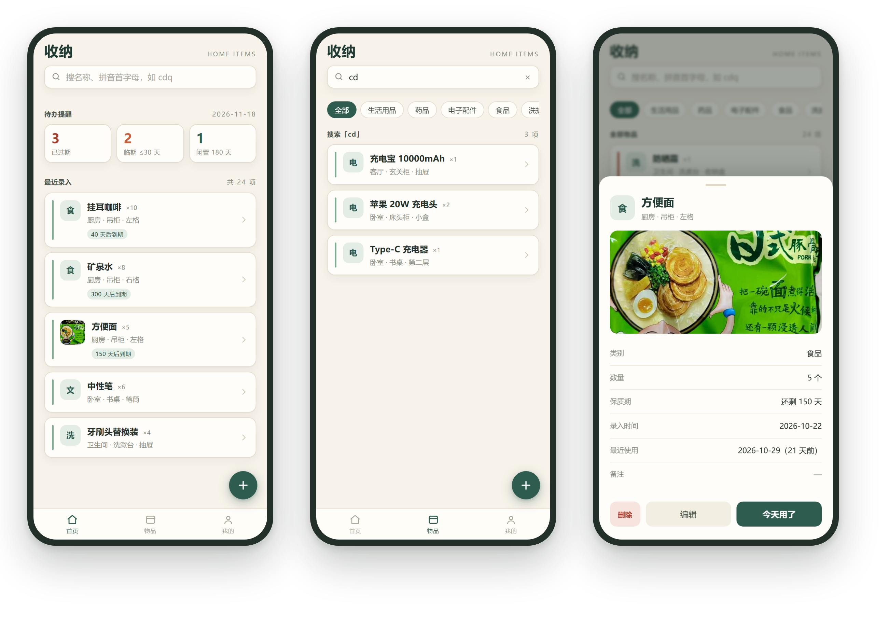

# 居家物品智能收纳管理助手 · P0 原型



单文件网页，双击 `index.html` 即可用。数据存在本机浏览器（IndexedDB，失败时退回 localStorage），不上传服务器。

推到 GitHub 后会自动发布到 GitHub Pages（见 [DEPLOY.md](DEPLOY.md)），地址形如 `https://用户名.github.io/仓库名/`。

## 怎么打开

| 方式 | 命令 | 拍照能力 |
| --- | --- | --- |
| 直接双击 `index.html` | — | `拍照`走**系统相机**（手机上直接唤起相机，桌面上是选文件） |
| 双击 `启动-实时取景版.cmd` | `node serve.js` | 打开 `http://localhost:8848`，**网页内实时取景**，点快门即拍 |
| 打开 Pages 链接（https） | — | 网页内实时取景直接可用，无需本地服务 |

浏览器只在 https / localhost 这类安全上下文里开放 `getUserMedia`。用 `file://` 打开时页面会走系统相机，不会弹摄像头授权。

## 已实现（P0 + 拍照）

- 录入：名称 / 类别 / 位置（房间·柜子·抽屉）/ 数量 / 保质期 / 备注 / **照片**
- 拍照：网页内实时取景（localhost）、系统相机、相册选图；自动压到长边 720px、JPEG 0.72，一张约 60–150KB
- 示例数据里「方便面」自带一张真实商品照（已内联进 `index.html`），恢复示例数据后即可看到带图录入的效果
- 搜索：名称、拼音首字母（`cdq` → 充电器）、分类筛选
- 保质期三态：正常 / 临期（≤30 天）/ 已过期，过期红标
- 闲置识别：超过 180 天未使用自动标记
- 统计：物品总数、种类数、分类分布条形图
- 数据：导出 JSON 备份（含照片）、导入恢复、恢复示例数据、清空

## 目录

```
index.html              主程序（自包含，无外部依赖，约 184KB，含一张示例照片）
build.js                生成 dist/（加 manifest、service worker、图标、响应头）
assets/                 PWA / iOS 图标源文件
serve.js                本地静态服务器（实时取景用）
启动-实时取景版.cmd     双击启动，自动开浏览器
.github/workflows/      push 后自动构建并发布到 GitHub Pages
DEPLOY.md               上传路线、坑点、演示现场建议
ppt/                    PPT 用图（整页版 / 拼版 / 单屏）与用法说明
预览-*.png             界面截图
```

## 验证过的东西

- 静态检查 9 项：语法、拼音、保质期三态、闲置阈值、种子数据、自包含、无内联事件
- jsdom 交互 26 项：三 Tab 切换、搜索、筛选、增删改、抽屉、统计
- 浏览器端到端：导出 → 清空 → 导入（24 项 / 75 件）、删除、详情渲染
- 拍照链路：实时取景（1600×1200）→ 快门 → 压缩（860×1864 → 332×720，18KB）→ 列表缩略图 → 详情大图 → 编辑回填 → 移除
- 导入导出往返：照片随 JSON 走，导入后缩略图与大图都在
- 窄屏 320 / 375 / 390 / 768 均无横向溢出
- 宽屏居中：430 / 887 / 1037 / 1280 / 1440 / 1920 六档视口下，内容、底部导航、FAB、弹层左右边缘完全一致（容差 1px）
- 桌面弹层：860 高视口下「保存」常驻可见，表单可滚动，未打开时不拦截页面点击

## 放到 PPT 里

`ppt/` 里有 8 张成图（透明背景，可直接拖进 PowerPoint / WPS）：
整页版 `ppt/整页-1920x1080.png` 铺满即是一页；`三屏并排.png`、`四屏并排.png` 用来自己配文字；`单屏-01~05` 放大讲某一屏。
细节见 [ppt/README.md](ppt/README.md)。

注意：PPT 里点不动，现场演示另开浏览器或手机「添加到主屏幕」。

## 已知边界

- 未接 AI 识别，名称仍需手输；照片只用于"认物"，不做识别
- 照片存本机，换设备要靠导出 / 导入 JSON
- localStorage 撑满 5MB 时会丢照片、保文字，并提示
